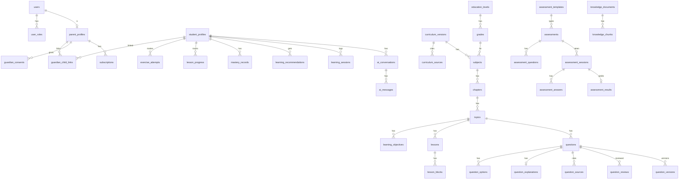

# Database ERD

52 tabel, migrasi `backend/alembic/versions/0001_initial_schema.py`. Semua relasi memakai foreign key.

Tabel lain: `media_assets`, `content_versions`, `content_reviews`, `ai_providers`, `ai_models`, `ai_prompt_versions`, `ai_usage_logs`, `ai_safety_events`, `subscription_entitlements`, `payments`, `notifications`, `audit_logs`, `sync_jobs`, `privacy_requests`.

## Indeks penting
- `exercise_attempts.client_uuid` unik (sinkron idempoten), indeks `(student_id)`, `(topic_id)`, `(answered_at)`.
- `assessment_sessions.submit_key` unik; `assessment_answers (session_id, question_id)` unik.
- `knowledge_chunks.tsv` GIN (kolom terhitung `to_tsvector('indonesian', content)`).
- `lessons.status`, `questions.status` untuk antrean review.

## Data anak yang disimpan
Nama panggilan, kelas, aktivitas belajar. Tidak ada nama lengkap, tanggal lahir, sekolah, foto, atau kontak anak.

## Retensi
| Data | Retensi |
|---|---|
| Aktivitas & nilai | selama akun aktif; dihapus permanen saat profil/akun dihapus |
| Percakapan AI | target 30 hari (job pembersihan belum dibuat, lihat KNOWN_ISSUES) |
| Log pemakaian AI | tanpa isi pesan; disimpan untuk kontrol biaya |
| Backup | 14 hari (layanan `backup` di Compose) |

## Backup & pemulihan
`docker compose` menjalankan `pg_dump -Fc` harian ke `./backups`. Pemulihan: `pg_restore -h HOST -U bobo -d bobo --clean backups/bobo-YYYYMMDD-HHMM.dump`. Uji pemulihan minimal sebulan sekali.
